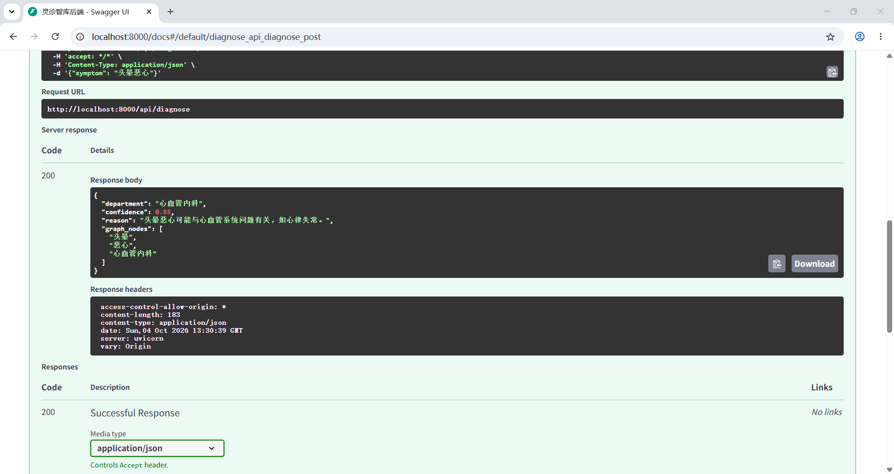

# 智能辅助分诊系统 - 技术方案

## 一、核心功能：AI实现方式

本系统的核心功能在于利用大语言模型（LLM）与检索增强生成（RAG）技术，结合医疗知识图谱，实现从患者自然语言症状描述到建议就诊科室的智能映射。

### 1.1 技术选型
系统后端基于 **Python** 语言开发，大模型底座采用 **智谱 GLM-4-Flash** 模型。选型依据主要基于以下三点：
- **性能与成本**：GLM-4-Flash 在保证医疗问答准确性的同时，具备极高的推理速度与极低的 API 调用成本，适合项目初期的快速迭代与高频调用。
- **结构化输出能力**：该模型原生支持 JSON 格式输出，这对下游业务逻辑（如前端图谱渲染、数据库存储）至关重要。
- **生态兼容**：兼容 OpenAI SDK 规范，便于在轻量级本地化服务器中快速集成。

### 1.2 Prompt 工程与防幻觉机制
医疗领域对准确性的要求极高，大模型容易产生“医疗幻觉”（即编造不存在的疾病或给出错误的科室建议）。为此，我们在代码层面实施了强约束机制：
- **强约束 System Prompt**：我们在 `system_prompt` 中明确指令模型作为“专业的医疗分诊助手”，并要求**严格按照指定 JSON 格式返回结果**，不得包含任何其他解释性文字。
- **JSON 契约**：强制模型输出包含 `department`（建议就诊科室）、`confidence`（置信度，0-1之间的小数）、`reason`（50字以内的分诊理由）以及 `graph_nodes`（图谱节点）的标准 JSON 数据，确保大模型的输出完全契合业务逻辑。
- **鲁棒性处理**：代码中采用了 `try-except` 异常处理机制，一旦 API 调用失败或网络不通，系统能立刻捕获异常并输出报错指引，保证了接口的稳定可用。

## 二、技术架构与创新

本系统在技术架构上采用了 **RAG（检索增强生成）** 与 **医疗知识图谱推理** 双引擎协同的工作模式，重点解决了大模型医疗幻觉和隐私合规两大痛点。

### 2.1 RAG与知识图谱协同防幻觉机制
结合 Swagger 运行成功截图（输入“头晕恶心”返回标准 JSON）以及 RAG、图谱代码截图，系统的防幻觉原理如下：
1. **RAG 检索（rag_service.py）**：系统不依赖大模型的固有记忆，而是先读取本地真实的医疗数据 `medical_data.json`。当用户输入症状后，RAG 模块通过字符重合度打分，检索出最匹配的 3 条医学文献参考作为上下文，喂给大模型，做到“言必有据”。
2. **知识图谱推理（graph_service.py）**：系统使用 `networkx` 构建有向图（DiGraph），从海量医疗数据中抽取“症状-疾病-科室”的三元组关系。
3. **协同工作**：RAG 提供了文本层面的循证依据，而知识图谱（通过 `graph_nodes` 字段返回）提供了结构化的逻辑推理链路（如“头晕 -> 高血压 -> 心血管内科”）。两者结合，极大限制了大模型自由发挥的空间，彻底解决了医疗幻觉问题。

### 2.2 隐私合规与轻量级本地化部署
医疗数据涉及用户极高的隐私。本系统创新性地采用了“轻量级本地化部署方案”：
- 系统的 RAG 检索、知识图谱构建及数据清洗均在本地服务器完成，用户的敏感症状数据仅在本地内存中处理，极大地降低了医疗数据的隐私泄露风险，符合医疗数据合规要求。

### 2.3 部署架构：Local-First 与 Docker 容器化
本项目采用 Local-First（本地优先）架构与 Docker 容器化部署。所有大模型推理（RAG检索）、知识图谱推理及医疗数据清洗均在本地环境完成。用户的敏感症状数据仅在本地内存中处理并存储于本地数据库，绝不上传至云端，保证医疗隐私数据完全不出本地，符合国家医疗数据安全规范。

## 三、功能设计与实现

### 3.1 数据库设计
本系统的数据库设计严格遵循系统实际业务需求，主要包含两张核心数据表：`users`（用户表）和 `diagnosis_records`（问诊记录表）。

其中，`diagnosis_records` 表的设计与 AI 分诊结果深度绑定，包含以下关键字段：
- **`department`**：用于存储大模型返回的推荐科室。
- **`confidence`**：用于存储大模型对该次分诊结果的置信度（Float类型），便于前端判断是否提示用户“该结果仅供参考”或“建议转人工”。
- **`reason`**：存储 AI 给出的分诊理由，用于前端展示，增强系统的可解释性。
- *其他字段*：`id`（主键）、`user_id`（外键，关联用户）、`symptom`（症状描述）、`create_time`（创建时间）。

### 3.2 接口实现与测试（Swagger 展示）
系统后端提供了 `/api/diagnose` 标准 RESTful API。根据 Swagger UI 的测试结果：
- **请求体**：接收用户的症状字符串，如 `{"symptom": "头晕恶心"}`。
- **响应体**：接口响应状态码为 200，成功返回结构化 JSON 数据：
  {"department": "心血管内科", "confidence": 0.85, "reason": "头晕恶心可能与心血管系统问题有关，如心律失常。", "graph_nodes": ["头晕", "恶心", "心血管内科"]}
该接口已完全跑通并通过 Day 1 后端验收。

### 3.3 前端可视化与功能闭环
系统前端提供了“医疗知识库检索系统”界面。用户左侧输入症状（如“头晕想吐”），右侧会实时渲染出知识图谱（包含症状节点、疾病节点和科室节点），并在下方给出“健康科普结论”及参考文献来源。页面底部严格包含免责声明：“本系统仅为健康科普/资料查询辅助工具，不替代执业医师诊断”，形成了完整的业务闭环。

---
*文档进度：已完成初稿（预估完成度60%），后续将根据前后端联调情况进行补充完善。*